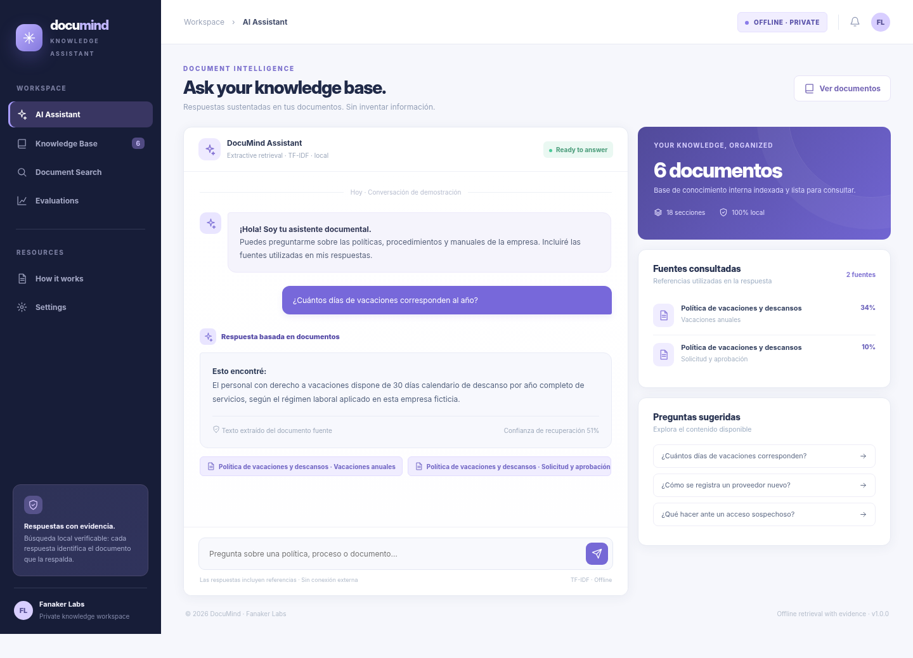
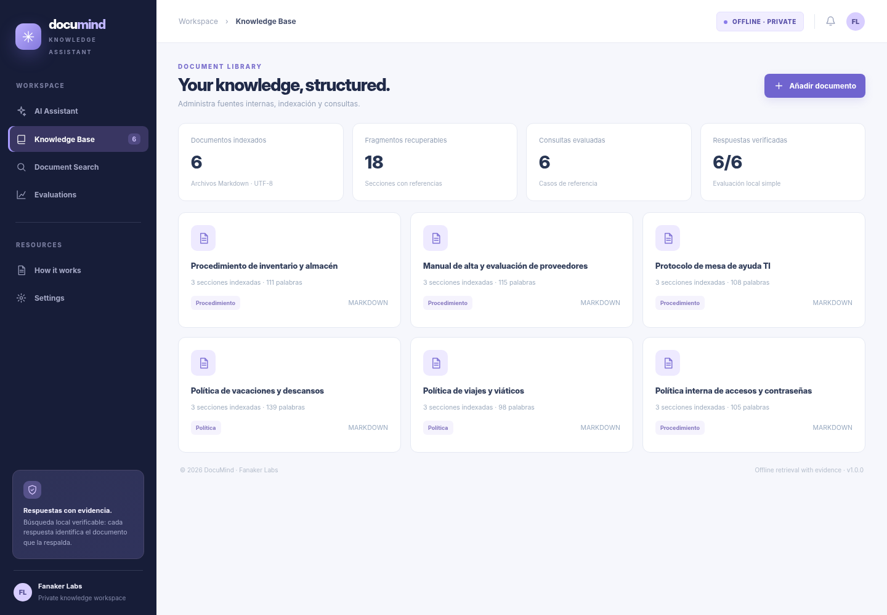
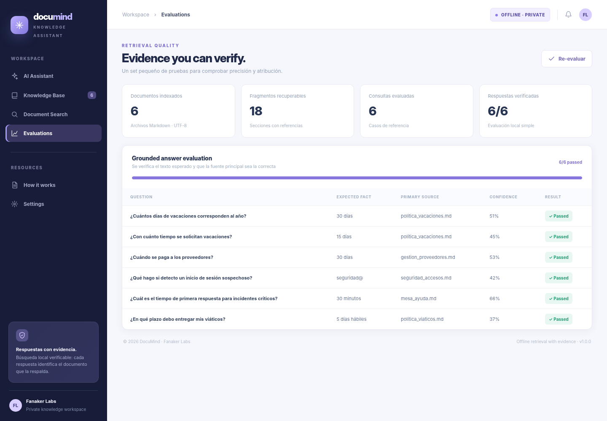
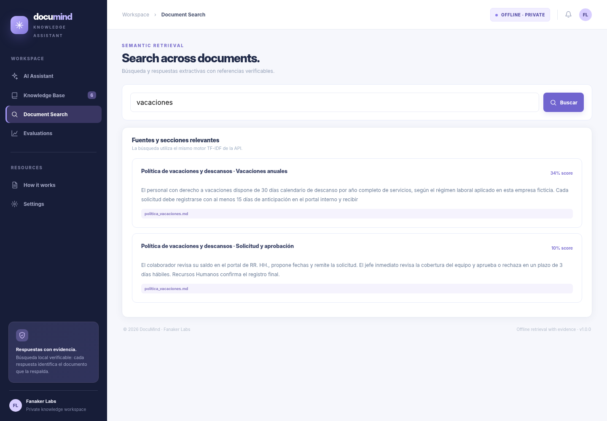
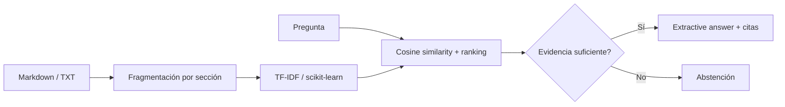

# DocuMind · Document Intelligence Assistant

**Proyecto de portafolio #14 · IA aplicada / NLP / Document Retrieval**

Asistente de consulta de documentación interna con referencias: indexa archivos Markdown/TXT, recupera secciones relevantes y responde **extrayendo texto de los documentos reales**, sin inventar respuestas cuando no hay evidencia suficiente. Funciona completamente en local y **no necesita API de pago**.

**Tecnologías:** Python · FastAPI · scikit-learn · TF-IDF · Cosine Similarity · NLP · REST API · HTML/CSS/JS · Pytest · GitHub Actions



## ¿Qué incluye?

- **Asistente documental:** preguntas en lenguaje natural, respuestas basadas en oraciones de las fuentes y citas con título, sección y archivo.
- **Base de conocimiento:** seis políticas y procedimientos **ficticios**, divididos en 18 secciones.
- **Carga de documentos:** archivos `.md` y `.txt` en UTF-8 de hasta 1 MB, con reindexación.
- **Búsqueda y ranking:** vectorización TF-IDF con scikit-learn, similitud del coseno y ajustes léxicos explicables.
- **Control de evidencia:** se abstiene ante preguntas fuera de los documentos indexados.
- **Evaluación simple:** seis preguntas con hechos esperados y verificación de fuente principal.
- **No se exponen archivos a APIs externas.**

## Otras vistas

| Biblioteca documental | Evaluación de recuperación |
|---|---|
|  |  |



Las capturas corresponden a la interfaz web de este repositorio, renderizada a partir de respuestas de la API con **datos de demostración**.

## Instalación local

Requisitos: Python **3.11+**.

```bash
python -m venv .venv
# Windows (PowerShell): .\.venv\Scripts\Activate.ps1
# macOS/Linux: source .venv/bin/activate
pip install -r requirements.txt
uvicorn app.main:app --reload
```

Abre **http://127.0.0.1:8000** y escribe una pregunta. API Swagger: **http://127.0.0.1:8000/docs**.

Ejemplos de preguntas:

- ¿Cuántos días de vacaciones corresponden al año?
- ¿Cómo se registra un proveedor nuevo?
- ¿Qué se hace ante un inicio de sesión sospechoso?
- ¿Cuál es el tiempo de respuesta de una incidencia crítica?
- ¿En qué plazo se entregan los viáticos?

## Cómo funciona la IA



**Aclaración técnica:** no se utiliza un LLM generativo. DocuMind es un prototipo de **recuperación documental extractiva con aprendizaje automático clásico**; no debe describirse como chatbot GPT, RAG con modelo generativo o análisis semántico basado en embeddings neuronales. La cifra de «confianza» del panel es una puntuación heurística de recuperación, no una probabilidad calibrada de veracidad.

## API

| Método | Endpoint | Función |
|---|---|---|
| GET | `/api/overview` | Documentos, métricas, demo y evaluación |
| POST | `/api/ask` | Respuesta con fuentes o abstención |
| GET | `/api/documents` | Archivos y secciones indexados |
| POST | `/api/documents/upload` | Añadir `.md` / `.txt` |
| GET | `/api/evaluation` | Verificación de seis preguntas |
| GET | `/health` | Estado del índice |

```json
{"question":"¿Cuántos días de vacaciones corresponden al año?"}
```

## Pruebas

```bash
python -m pytest -q
node --check web/app.js
```

La pequeña evaluación de seis preguntas se basa en los propios documentos ficticios y no es un benchmark externo ni una garantía general de precisión. También se prueba que rechace una pregunta no respaldada.

## Organización

```text
DocuMind/
├── app/
│   ├── main.py         # API, carga e índice
│   └── retrieval.py    # TF-IDF + ranking + citas
├── knowledge/           # Seis documentos Markdown ficticios
├── web/                 # Interfaz web responsive
├── tests/               # API, recuperación y validaciones
├── docs/screenshots/    # Capturas
└── .github/workflows/   # CI
```

Ideal para explicar NLP básico, búsqueda de información, métricas de recuperación, validación de evidencia y límites de una solución de IA.

---

**Proyecto de demostración para portafolio · Fanaker Labs · 2026**
